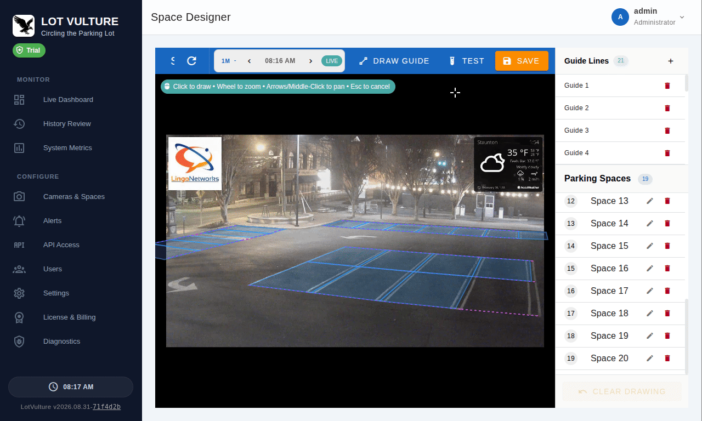
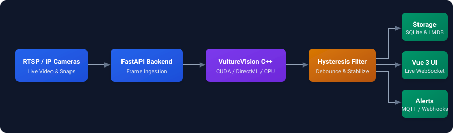

# Lot Vulture 🦅
### Intelligent, Edge-Accelerated Parking Lot Occupancy & Analytics

[-blue.svg)](./LICENSE.md)
[](https://github.com/lotvulture/lotvulture/pkgs/container/lotvulture)
[](#-quickstart)
[%20%7C%20GPU%20(Commercial)-blue.svg)](#-community-vs-commercial-editions)
[](https://www.python.org/)
[](https://vuejs.org/)

**Lot Vulture** turns any existing IP or RTSP camera into an automated, real-time parking lot intelligence system. *Circling the lot so you don't have to*, Lot Vulture performs on-device computer vision inference directly on your camera feeds—delivering live space-level occupancy maps, historical scrubbing timelines, customizable alerts, and deep parking utilization analytics without requiring expensive physical in-ground sensors.

---

## 🎬 Demo

<p align="center">
  
</p>

---

## 🏢 Why Lot Vulture?

| Challenge with Traditional Solutions | How Lot Vulture Solves It |
| :--- | :--- |
| **In-Ground Magnetic Sensors ($200–$500/spot):** Expensive to core-drill, battery-dependent, and frequently destroyed by snowplows and asphalt repaving. | **Uses Existing Cameras:** Turn standard CCTV, RTSP, or snapshot IP cameras into smart parking sensors with zero pavement alteration. |
| **Proprietary Sensor Hardware & Vendor Lock-In:** Requires purchasing expensive proprietary single-vendor cameras or per-space overhead light indicators. | **Camera & Hardware Agnostic:** Works with any standard RTSP, ONVIF, or snapshot IP camera from any manufacturer (Hikvision, Dahua, Axis, Hanwha, Ubiquiti, etc.). |
| **Noisy AI & False Flickers:** Minor lighting shifts or tree shadows cause constant "space full / space free" notification spam. | **Dual-Threshold Hysteresis:** Sticky state transitions ensure rock-solid, flicker-free dashboard data. |
| **Manual Lot Audits:** Attendants driving golf carts with clipboards or radios providing only delayed, periodic estimates. | **Live Digital Dashboard & Historical Timeline:** Real-time occupancy map, second-by-second scrubbing, and automated alerting. |

---

## ✨ Core Features

- 📍 **Interactive Visual Space Editor:** Define exact parking spots in seconds with a high-precision polygon canvas powered by Vue-Konva. Supports angled, parallel, and tight-row parking configurations.
- ⚡ **High-Performance Edge AI Engine:** Powered by `vulturevision` (C++ ONNX Runtime with optimized CPU inference for Community Edition; CUDA & DirectML hardware acceleration in Commercial Edition).
- 🔭 **Visual Scrubbing History Timeline:** Scrub through every minute of the day with second-by-second precision. Click any space to see exact visual snapshots of state transitions.
- ⚙️ **Smart Sensitivity (Hysteresis Logic):** Dual-threshold certainty eliminates status bouncing during dusk, rain, snow, or transient occlusions.
- 🔔 **Multi-Channel Alerting Subsystem:** Trigger Webhooks, MQTT messages (ideal for Home Assistant & smart signage), or Emails on lot capacity thresholds, single space transitions, or camera health events.
- 🔄 **Human-in-the-Loop "Improve AI" Feedback:** Operators can flag and correct misdetections directly from the UI to continuously feed the training pipeline.
- 🛡️ **Role-Based Multi-User Access:** Granular roles for operators, managers, and view-only analytics dashboards.

---

## 🚀 Quickstart

### Option 1: Windows Native Installer (Recommended for Windows)

Download the latest standalone installer (`LotVulture_Setup_*.exe`) from the **[Releases](https://github.com/lotvulture/lotvulture/releases)** page.
- Packages the complete web dashboard, C++ inference runtime, and background Windows service daemon.
- No WSL, Docker, or external dependencies required.
- Launch the app or open `http://localhost:8000` in your browser.

---

### Option 2: Docker (Linux)

Run the official container:

```bash
docker run -d \
  --name lotvulture \
  --restart unless-stopped \
  -p 8000:8000 \
  -v lotvulture-data:/var/lib/lotvulture \
  ghcr.io/lotvulture/lotvulture:latest
```

*(Commercial Edition license holders running on NVIDIA GPUs can pass `--gpus all` to enable hardware acceleration.)*

Access the dashboard at **`http://localhost:8000`**.

---

### Option 3: Docker Compose

```yaml
version: '3.8'

services:
  lotvulture:
    image: ghcr.io/lotvulture/lotvulture:latest
    container_name: lotvulture
    restart: unless-stopped
    ports:
      - "8000:8000"
    environment:
      - VULTURE_LV_HOME=/var/lib/lotvulture
    volumes:
      - lotvulture-data:/var/lib/lotvulture
    # Optional GPU reservation for Commercial Edition:
    # deploy:
    #   resources:
    #     reservations:
    #       devices:
    #         - driver: nvidia
    #           count: all
    #           capabilities: [gpu]
```

Run with:
```bash
docker compose up -d
```

---

## 🚦 How It Works

<p align="center">
  
</p>

1. **Connect Your Cameras:** Add RTSP stream URLs or snapshot endpoints in the Cameras view.
2. **Draw Parking Zones:** Use the visual canvas editor to map the four corners of each space.
3. **Automate & Monitor:** Real-time occupancy states stream immediately over WebSockets to your live dashboard.
4. **Trigger Actions:** Stream lot availability to digital LED road signs via MQTT, notify staff when capacity hits 95%, or log audit history.

---

## 💎 Community vs. Commercial Editions

Lot Vulture is source-available with a commercial tier:

| Feature | Community Edition | Commercial License |
| :--- | :---: | :---: |
| **Inference Model** | Bundled Standard Model | High-Accuracy Commercial Model |
| **Inference Hardware** | Optimized CPU | GPU (CUDA / DirectML) + CPU |
| **Visual Space Editor & Live Dashboard** | ✅ Included | ✅ Included |
| **Visual History Timeline & Scrubbing** | ✅ Included | ✅ Included |
| **Webhooks & MQTT Alerts** | ✅ Included | ✅ Included |
| **Commercial Monitoring Services** | ✅ Permitted (with baseline model) | ✅ Permitted (with licensed seats) |
| **Cloud Telemetry & Continuous Retraining** | — | ✅ Included |
| **Priority Support & Multi-Camera Scaling** | Community | Dedicated |

To activate a commercial license or start a free 14-day trial, navigate to the **License & Billing** tab in your dashboard.

---

## 🔌 Developer Cloud API

Want on-demand parking space detection in your own application without managing on-prem infrastructure?

Use the **[Lot Vulture Developer Cloud API](https://www.lotvulture.com/developer.html)** ($0.02 / image):

```bash
curl -X POST "https://api.lotvulture.com/v1/detect" \
  -H "Authorization: Bearer YOUR_API_KEY" \
  -F "image=@parking_lot.jpg" \
  -F 'rois=[[[120,340],[250,340],[260,490],[110,490]]]'
```

---

## 🛠️ Development & Documentation

- **[Developer Guide](./docs/DEVELOPMENT.md):** Architecture deep dive, local environment setup, and C++ engine compilation.
- **[Testing Guide](./docs/TESTING.md):** Running unit, integration, and performance tests.
- **[Contribution Guidelines](./CONTRIBUTING.md):** Guidelines for community contributions and pull requests.

---

## 📜 License

Copyright (c) 2026 Lot Vulture, LLC. All rights reserved.

This software is licensed under the **[Lot Vulture Source License 1.0.0 (Adapted from PolyForm Shield License 1.0.0)](./LICENSE.md)**.

- **Permitted Use:** Broad permission to run, modify, and utilize the software internally and for commercial monitoring services.
- **Noncompete Condition:** You may not use the software to build, distribute, or sell a competing product or managed service, nor distribute modified vision engines designed to bypass licensing.
- **Commercial Model:** High-accuracy commercial neural network weights and cloud attestation assets are licensed separately under the [Commercial Terms of Service](./LICENSE.md#definitions).

---

<p align="center">
  <b>Lot Vulture</b> — <i>Making parking smarter, one spot at a time.</i><br>
  <a href="https://lotvulture.com">Website</a> • <a href="https://github.com/lotvulture/lotvulture/issues">Report an Issue</a>
</p>
